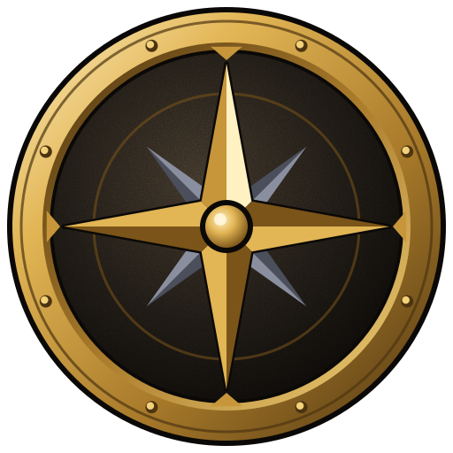

# Forever Coach

**Dein Begleiter für WoW Forever.** Forever Coach läuft neben dem Spiel, erkennt deinen Charakter automatisch und zeigt dir passend dazu, was du als Nächstes tun solltest: Skillung, Rotation, Berufe, Ausrüstung und Gold. Er ist für den zweiten Monitor gedacht und kann zusätzlich als Overlay direkt über dem Spiel laufen.

> Dieses Repository enthält nur die **fertigen Installer** (unter [Releases](../../releases)) und diese Anleitung. Die App aktualisiert sich von hier aus selbst.

---

## Was der Forever Coach kann

- **Erkennt jeden Charakter automatisch:** Klasse, Volk, Stufe, Talente, Ausrüstung, Berufe, Taschen, Gold und Gruppe. Ein neuer Charakter wird beim nächsten Login erkannt.
- **Coachboard für den zweiten Monitor** im WoW-Stil, mit echten Spiel-Icons:
  - **Hinweise**, sortiert nach „Jetzt / Bald / Info“: freie Talentpunkte mit dem nächsten Talent laut Guide, Lehrerbesuche, nächster Berufsrang, fehlende Materialien mit Auktionshauspreis, volle Taschen, Dungeons in deinem Stufenbereich, Synergien mit deiner Gruppe und Gold-Tipps
  - **Guide:** Skillung Punkt für Punkt, Rotation als Prioritätenliste (Quelle: Wowhead)
  - **Berufe:** Skillroute Schritt für Schritt mit Einkaufsliste und Preisen (Quelle: GoldGoblin)
  - **Gold:** Gold-Tipps für Forever passend zu deinen Berufen
  - **Talente:** Talentbaum-Rechner, mit dem du zwei Skillungen per Simulation vergleichst
  - **Ausrüstung:** veraltete Teile, dazu **Top Gear**: findet die beste Kombination aus deinen Taschen und deiner Bank per Simulation
  - **Sitzungen:** Auswertung jeder Spielsitzung mit EP/h, Gold/h, Materialwert, Verlauf und Bestwerten
- **Overlay**, halbtransparent über WoW: Stufe, die wichtigsten Hinweise und die Rotation. Per Hotkey schaltest du es durchklickbar. Es funktioniert im **randlosen Fenstermodus**, nicht im exklusiven Vollbild.
- **Preise** aus **Auctionator** und **TradeSkillMaster**. Die TSM-Desktop-App aktualisiert sie auch ohne laufendes Spiel.
- **RestedXP:** Der Coach erkennt deinen aktuellen Guide-Schritt und plant seine Hinweise passend zur Route. Er zeigt weder Quests noch Laufwege, das macht RestedXP selbst.
- **Deutsch und Englisch.**

## Voraussetzungen

- Windows 10 oder 11
- World of Warcraft: **WoW Forever**, für das Overlay im **randlosen Fenstermodus**
- Optional: Auctionator, TradeSkillMaster, RestedXP

## Installation

1. Unter [**Releases**](../../releases/latest) die Datei **`ForeverCoach-Setup-<Version>.exe`** herunterladen.
2. Datei ausführen. Die Installation läuft nur für deinen Windows-Benutzer, Admin-Rechte sind nicht nötig.
   - Der Installer ist **nicht signiert**. Zeigt Windows „Der Computer wurde durch Windows geschützt“, klicke auf **Weitere Informationen → Trotzdem ausführen**.
3. **Forever Coach starten.** Der Einrichtungs-Assistent führt dich durch drei Schritte:
   1. **WoW-Ordner:** Der Assistent findet ihn meist automatisch, sonst wählst du ihn aus.
   2. **Add-on installieren:** Ein Klick kopiert das Add-on „ForeverCoach“ in deinen WoW-AddOns-Ordner.
   3. **Im Spiel:** WoW starten bzw. neu starten, das Add-on in der Add-on-Liste aktivieren und einloggen.
4. **Fertig.** Sobald du im Spiel bist, zeigt das Coachboard deinen Charakter.

### Daten aktualisieren

WoW schreibt Add-on-Daten nur beim Neuladen der Oberfläche auf die Festplatte. Damit der Coach aktuelle Daten bekommt, hast du drei Möglichkeiten:

- **Minimap-Knopf** des Forever Coach anklicken: Daten senden, die Oberfläche lädt kurz neu.
- Eine **Taste** belegen: *Tastaturbelegung → Forever Coach: Daten senden*.
- Oder **`/reload`** eingeben.

Ausloggen und Charakterwechsel aktualisieren die Daten ebenfalls automatisch.

### Add-on manuell installieren (optional)

Falls die automatische Installation nicht klappt: `ForeverCoach-Addon-<Version>.zip` aus dem Release herunterladen und nach `World of Warcraft\_<Spielversion>_\Interface\AddOns\` entpacken. Danach liegt dort ein Ordner `ForeverCoach`.

## Updates

Forever Coach sucht beim Start und alle 6 Stunden nach neuen Versionen. Ist eine da, erscheint ein Hinweis im Coachboard. Heruntergeladen und installiert wird **erst nach deinem Klick**, nie während eines Kampfes. Läuft WoW, fragt die App vorher nach. Ist eine neuere Version des Add-ons enthalten, bietet die App an, sie in deinen WoW-Ordner zu kopieren. Danach `/reload` oder WoW neu starten.

## Overlay und Tastenkürzel

| Aktion | Standard |
|---|---|
| Overlay durchklickbar an/aus | `Alt+Shift+C` |
| Overlay ein-/ausblenden | `Alt+Shift+O` |

Du kannst beides in den Einstellungen ändern (Zahnrad oben rechts). Dort stellst du auch den Startmodus ein: Coachboard und Overlay, nur Coachboard oder nur Overlay. Bei „nur Overlay“ lebt die App im Infobereich der Taskleiste.

## Datenschutz

- Forever Coach läuft **komplett lokal** auf deinem PC. Es gibt kein Konto, keinen Login und keine Telemetrie.
- Gelesen werden nur die Dateien deiner Add-ons im WoW-Ordner: ForeverCoach, Auctionator, TradeSkillMaster und den Fortschritt von RestedXP.
- Verbindungen ins Internet gibt es nur für Guides von **Wowhead** und **GoldGoblin**, Icons von Wowhead und die Update-Prüfung hier auf GitHub. Abgerufen wird zurückhaltend und mit Cache.
- Von RestedXP liest der Coach nur, **wo** du im Guide stehst. Guide-Inhalte werden nicht ausgelesen oder weitergegeben.

## Probleme?

- **Charakter erscheint nicht:** Ist das Add-on in der Add-on-Liste aktiviert? Klicke einmal auf den Minimap-Knopf oder gib `/reload` ein. Im Spiel zeigt `/fc` den Status des Add-ons.
- **Overlay ist nicht zu sehen:** WoW muss im **randlosen Fenstermodus** laufen.
- **Add-on gilt als „veraltet“:** In der Add-on-Liste „Veraltete Add-ons laden“ anhaken und ein Update des Forever Coach abwarten.

## Danksagung und Hinweise

- Simulation: [**WoWSims Forever**](https://github.com/wowsims/forever) (MIT-Lizenz)
- Guides: [**Wowhead**](https://www.wowhead.com/forever) und [**GoldGoblin**](https://classic.goldgoblin.net). Inhalte und Links gehören den jeweiligen Seiten.
- World of Warcraft und Blizzard Entertainment sind Marken oder eingetragene Marken von Blizzard Entertainment, Inc. Forever Coach ist ein privates Fan-Projekt und steht in keiner Verbindung zu Blizzard Entertainment, Wowhead, GoldGoblin, RestedXP oder TradeSkillMaster.

---

*English: Forever Coach is a Windows companion app for WoW Forever. Download `ForeverCoach-Setup-<version>.exe` from [Releases](../../releases/latest), run it (unsigned: “More info → Run anyway”), and follow the setup wizard. The app is available in English: switch the language in Settings.*
